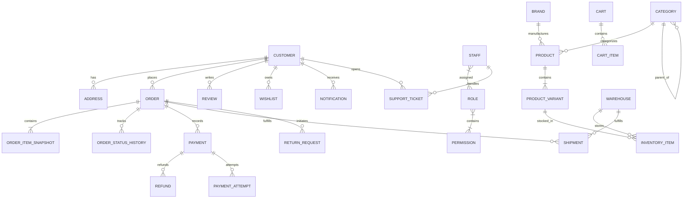

# VÉRONA — Phase 03: Database Architecture & Data Model Documentation

This document establishes the persistence architecture, domain models, indexing guidelines, data integrity rules, and operational strategies for **VÉRONA**, a production-grade full-stack fashion e-commerce platform.

---

## 1. Database Technology Selection & Rationale

* **Technology**: MongoDB 8.x
* **Object-Document Mapper (ODM)**: Mongoose 8.x
* **Language**: TypeScript 5.7+ (Strict Mode)

### Rationale
1. **Continuation of Phase 01 Architecture**: Phase 01 established a connection pooling singleton and ODM interface using Mongoose. Maintaining this choice avoids dual ORM/ODM competing abstractions and ensures architectural continuity.
2. **Fashion E-Commerce Polymorphism**: Fashion apparel features dynamic specifications (fabric compositions, wash care, sizing matrices, seasonal collections) that naturally map to document models without requiring deep, expensive relational joins.
3. **Strict Schema Constraints**: While MongoDB offers schema flexibility, Mongoose enables strict schema validation, default values, compound indexes, unique constraints, and pre-save lifecycle hooks.
4. **Connection Caching for Serverless / Next.js**: Hot-reloading in development and serverless routing environments require connection reuse to prevent connection exhaustion. The singleton pattern in `db/client.ts` caches connections globally across hot reloads.

---

## 2. Architectural Boundaries & Data Access Rules

To preserve the **Modular Monolith** architecture, database access strictly adheres to layered boundaries:

```text
Storefront / Admin UI
       ↓
Route Handler / Server Action
       ↓
Domain Service Layer (e.g. CatalogService, OrderService)
       ↓
Data Access Repository (e.g. ProductRepository, OrderRepository)
       ↓
Mongoose Model Layer (e.g. ProductModel, OrderModel)
       ↓
MongoDB (verona database)
```

### Prohibitions
* **NEVER** query MongoDB directly from React components or Client Components (`"use client"`).
* **NEVER** expose internal MongoDB document structures directly when DTOs are appropriate.
* **NEVER** expose raw database connection strings, database credentials, or secret keys to the client browser.

---

## 3. High-Level Entity Relationship Diagram



---

## 4. Collections & Domain Catalog

The persistence layer is structured into **13 business domains** across **42 Mongoose models/collections**:

| Domain | Collection Name | Mongoose Model | Purpose |
| :--- | :--- | :--- | :--- |
| **Identity** | `customers` | `CustomerModel` | Customer profiles, external identity mapping, preferences |
| | `staff` | `StaffModel` | Internal operators, role references, contact details |
| | `roles` | `RoleModel` | RBAC roles (Super Admin, Inventory Manager, Support, etc.) |
| | `permissions` | `PermissionModel` | Granular permission definitions (`orders.update`, etc.) |
| **Catalog** | `categories` | `CategoryModel` | Unlimited-depth hierarchical categories (Men, Women, Kids) |
| | `brands` | `BrandModel` | Fashion brand registries with unique slugs and logos |
| | `products` | `ProductModel` | Parent fashion items (fabric, fit, season, occasion) |
| | `product_variants` | `ProductVariantModel` | Color + Size SKUs, pricing overrides, weight, dimensions |
| | `colors` | `ColorModel` | Standardized hex palette entries with display ordering |
| | `size_attributes` | `SizeAttributeModel` | Standard alpha/numeric sizing system taxonomy |
| | `fashion_collections`| `FashionCollectionModel` | Curated edits (e.g. Summer Edit, Festive Atelier) |
| **Inventory** | `warehouses` | `WarehouseModel` | Physical fulfillment centers and hubs |
| | `inventory_items` | `InventoryItemModel` | Variant stock levels (available, reserved, damaged) |
| | `stock_movements` | `StockMovementModel` | Immutable stock movement ledger (RESTOCK, SALE, etc.) |
| | `stock_reservations`| `StockReservationModel`| Temporary checkout inventory holds with TTL expiration |
| **Commerce** | `addresses` | `AddressModel` | Customer shipping/billing addresses |
| | `carts` | `CartModel` | Customer & guest active carts |
| | `cart_items` | `CartItemModel` | Cart items with current price & product snapshots |
| | `wishlists` | `WishlistModel` | Customer wishlists |
| | `wishlist_items` | `WishlistItemModel` | Wishlist variant/product references with compound uniqueness |
| | `recently_viewed` | `RecentlyViewedModel` | Track viewed products per customer/session |
| | `coupons` | `CouponModel` | Discount codes, validations, cart constraints |
| | `campaigns` | `CampaignModel` | Marketing sales campaigns, category/product targets |
| **Orders** | `orders` | `OrderModel` | Customer orders with complete immutable snapshots |
| | `order_status_history`| `OrderStatusHistoryModel`| Append-only audit trail of order lifecycle transitions |
| **Payments** | `payments` | `PaymentModel` | Order payments, gateway references, settlement status |
| | `payment_attempts` | `PaymentAttemptModel` | Idempotent transaction attempts and gateway response payloads |
| | `refunds` | `RefundModel` | Item return/cancellation refunds with gateway IDs |
| **Shipping** | `shipments` | `ShipmentModel` | Carrier tracking, fulfillment warehouse, status |
| | `shipment_events` | `ShipmentEventModel` | Carrier webhook events and waypoint tracking |
| **Returns** | `return_requests` | `ReturnRequestModel` | Customer return requests, item conditions, photo proof |
| | `exchange_requests` | `ExchangeRequestModel` | Variant exchange requests and status |
| **Reviews** | `reviews` | `ReviewModel` | Customer ratings, verified purchase status, helpful votes |
| **Communication** | `notifications` | `NotificationModel` | In-app notification inbox |
| | `notification_preferences` | `NotificationPreferenceModel` | Email/SMS/WhatsApp opt-in preferences |
| | `email_events` | `EmailEventModel` | Email delivery, open, and click tracking |
| **Support** | `support_tickets` | `SupportTicketModel` | Customer helpdesk tickets and assignments |
| | `support_messages` | `SupportMessageModel` | Conversation threads on support tickets |
| **Content** | `banners` | `BannerModel` | Promotional banners for hero/category headers |
| | `homepage_sections`| `HomepageSectionModel`| Curated storefront homepage layouts |
| **Administration**| `audit_logs` | `AuditLogModel` | Immutable operational audit logs for compliance |
| | `system_settings` | `SystemSettingsModel` | Configurable system-wide parameters (non-secret) |

---

## 5. Core Architectural Decisions

### 5.1 ID Strategy
* **Format**: MongoDB `Types.ObjectId` (represented as 24-character hexadecimal strings at API boundaries).
* **Benefits**: Globally unique, timestamp-embedded, native index efficiency, and compatible with Mongoose `.populate()`.
* **Human-Readable Business IDs**:
  * Orders: `VER-ORD-2026-XXXXX`
  * Shipments: `VER-SHP-2026-XXXXX`
  * Refunds: `VER-REF-2026-XXXXX`
  * Support Tickets: `VER-TCK-2026-XXXXX`

### 5.2 Money Representation (Integer Minor Units)
* **Strategy**: Floating-point numbers are strictly forbidden for currency and price calculations to prevent binary IEEE 754 precision rounding errors.
* **Storage**: Stored as **integer minor units** (e.g., paise for INR).
  * Example: ₹1,299.50 is stored as `129950`.
  * Currency field defaults to `"INR"`.
* **Enforcement**: Mongoose schema validators enforce `Number.isInteger` on all monetary fields (`mrp`, `sellingPrice`, `subtotal`, `tax`, `discount`, `total`, `amount`).

### 5.3 Fashion Variant Strategy
* Separate `Product` (parent concept) and `ProductVariant` (purchasable SKU).
* **Compound Unique Constraint**: `{ productId: 1, "color.name": 1, size: 1 }` ensures that duplicate color + size variants cannot exist under the same parent product.
* **SKU Uniqueness**: `sku` is globally unique, uppercase, and indexed.

### 5.4 Multi-Warehouse Inventory Architecture
* **Variant-Level Stock**: Inventory is tracked per-variant per-warehouse via `InventoryItem`.
* **Compound Unique Constraint**: `{ warehouseId: 1, variantId: 1 }`.
* **Integrity Constraints**: `availableQuantity >= 0`, `reservedQuantity >= 0`. Negative stock is rejected at schema level.
* **Stock Movement Audit Trail**: Every movement (`RESTOCK`, `SALE`, `RESERVATION`, `DAMAGE`) records an immutable `StockMovement` entry capturing `beforeQuantity`, `afterQuantity`, reference IDs, and user identity.
* **Stock Reservation with TTL**: `StockReservation` employs a MongoDB TTL index on `expiresAt` (`{ expires: "0s" }`) to automatically clean up abandoned checkout reservations after a configured timeout (e.g., 15 minutes).

### 5.5 Snapshot Strategy for Historical Immutability
A common defect in e-commerce platforms is referencing mutable product and address documents in historical orders. In VÉRONA:
1. **Order Items**: Capture an immutable snapshot at checkout:
   * `productName`, `brandName`, `sku`, `size`, `color`, `image`, `unitPrice`, `discount`, `tax`, `finalPrice`.
   * Future price updates or catalog alterations do NOT alter historical invoices.
2. **Order Addresses**: Completely snapshots delivery and billing addresses at checkout. Customer profile address edits do not mutate past orders.
3. **Cart Items**: Retains price and variant snapshots at time of adding to cart to facilitate price-change warnings during checkout.

### 5.6 Soft Delete Strategy
* **Master Records**: Customer, Staff, Product, Category, Brand, Coupon, and Campaign models include `isDeleted: boolean` and `deletedAt: Date | null`.
* **Transactional Records**: Orders, Payments, Refunds, Shipments, Stock Movements, and Audit Logs are **append-only** and **NEVER soft-deleted**.

### 5.7 Indexing Strategy
Indexes are designed around actual query access patterns:
* **Product Discovery**: `{ slug: 1 }`, `{ status: 1, gender: 1, createdAt: -1 }`, `{ brandId: 1, status: 1 }`, `{ categoryIds: 1, status: 1 }`.
* **Variant Lookups**: `{ sku: 1 }`, `{ productId: 1, "color.name": 1, size: 1 }`.
* **Customer Orders**: `{ customerId: 1, createdAt: -1 }`, `{ status: 1, createdAt: -1 }`, `{ orderNumber: 1 }`.
* **Cart & Wishlist**: `{ customerId: 1, status: 1 }`, `{ customerId: 1, productId: 1, variantId: 1 }`.
* **Inventory**: `{ warehouseId: 1, variantId: 1 }`, `{ variantId: 1, status: 1 }`.
* **Audit Trail**: `{ entityType: 1, entityId: 1, createdAt: -1 }`, `{ actorId: 1, createdAt: -1 }`.

### 5.8 Concurrency & MongoDB Transaction Strategy (Phase 04+ Preparation)
MongoDB multi-document transactions (`session.withTransaction`) will be utilized in later phases for critical business boundaries:
1. **Checkout & Order Creation**: Atomic stock reservation + order drafting + payment intent creation.
2. **Payment Webhook Handling**: Idempotency check + payment state capture + stock deduction (`availableQuantity -= qty, reservedQuantity -= qty`) + order state advancement.
3. **Refund Processing**: Refund record creation + order state update + inventory restock (if item returned).

---

## 6. Seed & Development Infrastructure

* **Seed Script**: `db/seed.ts` provides `runDatabaseSeed({ clean?: boolean })`.
* **Deterministic Test Data**:
  * 19 RBAC Permissions
  * 7 System Roles (Super Admin, Admin, Inventory Manager, Order Manager, Support Agent, Marketing Manager, Warehouse Staff)
  * 1 Development Administrator (`admin@verona.internal`)
  * 1 Development Customer (`customer@test.verona.internal`)
  * 6 Standard Colors (Obsidian Black, Ivory Pearl, Royal Navy, Olive Earth, Crimson Velvet, Champagne Gold)
  * 6 Standard Apparel Sizes (XS, S, M, L, XL, XXL)
  * 11 Hierarchical Categories (Men, Women, Kids and their subcategories)
  * 4 Luxury Brands (VÉRONA Atelier, Aurelia Milano, Maison Royale, Noir & Blanc)
  * 4 Fashion Products with rich specifications, care guides, and image galleries
  * 24 Product Variants across colors and sizes (including discounted items and out-of-stock items)
  * 2 Regional Fulfillment Warehouses (Mumbai Central, Bengaluru South)
  * 48 Multi-warehouse Inventory Items
  * 2 Curated Collections (The Noir Collection, Summer Atelier 2026)
  * 2 Active Promotional Coupons (`WELCOME10`, `VERONA500`)

---

## 7. Migration & Schema Evolution Strategy

1. **Schema Changes**: Defined incrementally via typed Mongoose schemas in `db/schemas/`.
2. **Index Synchronization**: Handled via `syncDatabaseIndexes()` in `db/indexes.ts`, which runs `.syncIndexes()` against MongoDB collections.
3. **Zero-Downtime Indexing**: In production MongoDB Atlas clusters, index changes should be applied via rolling index builds or MongoDB Atlas UI.
4. **Data Migrations**: Versioned data migrations will be scripted using programmatic migration scripts executed against the repository layer.
