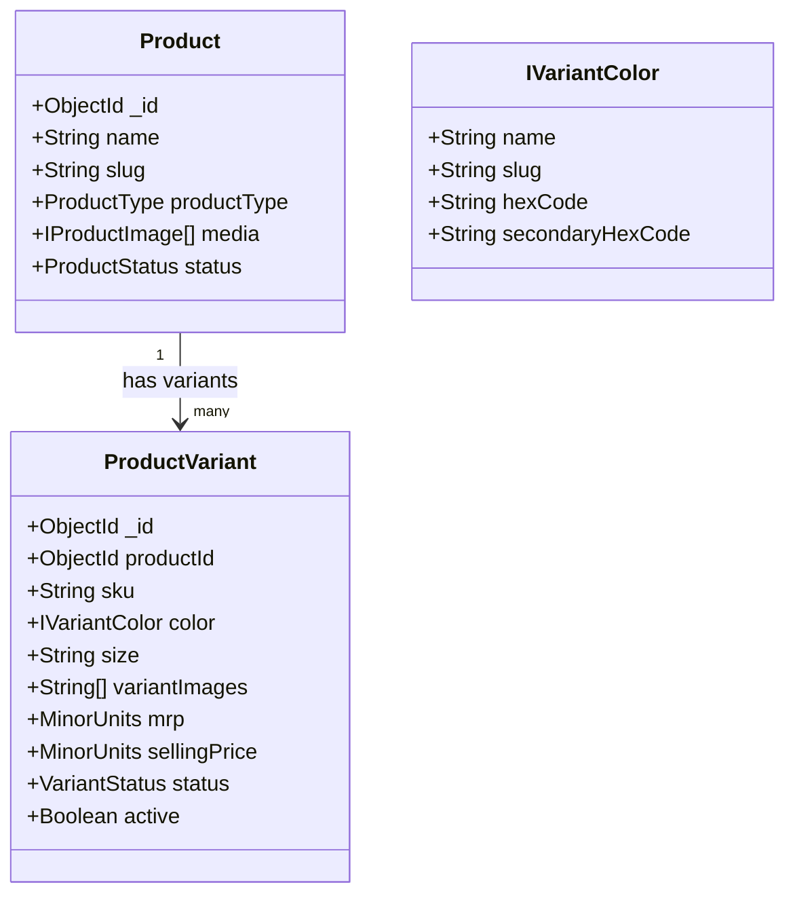

# VÉRONA — Garment Variant & Size System Architecture (Phase 12)

## 1. Executive Summary

In luxury fashion e-commerce, the purchasable unit is almost never the generic parent product alone; it is an exact, distinct variant silhouette defined by:

$$\text{Product} \times \text{Color} \times \text{Size} \rightarrow \text{Canonical Variant (Unique SKU)}$$

Phase 12 builds the canonical **Garment Variant & Size System** for VÉRONA. It establishes stable variant identities, deterministic SKU generation, color normalization and swatching, size schemes and deterministic ordering, cross-availability matrix calculations, variant-specific pricing and media synchronization, and rigorous boundary interfaces for downstream phases (Wishlist in Phase 13, Cart in Phase 14, Orders in Phase 18, and Inventory in Phase 20).

---

## 2. Strict Phase Boundaries

In accordance with VÉRONA engineering principles, Phase 12 strictly implements catalog and variant resolution mechanisms while deferring transactional operations:

| Feature Domain | Phase Owner | Status in Phase 12 |
| :--- | :--- | :--- |
| **ProductVariant Model & Uniqueness** | Phase 03 / Phase 12 | **IMPLEMENTED** (Domain & Compound DB Index) |
| **Color Domain & Normalization** | Phase 12 | **IMPLEMENTED** (Hex, Gradients, Pattern Images) |
| **Size Schemes & Deterministic Ordering**| Phase 12 | **IMPLEMENTED** (Letter, Numeric, Waist, Age, One-Size) |
| **Color $\times$ Size Availability Matrix** | Phase 12 | **IMPLEMENTED** (O(1) cross-reference lookups) |
| **Exact Variant Resolution** | Phase 12 | **IMPLEMENTED** (Strict rejection, no fallback) |
| **Deterministic SKU Generation & Validation**| Phase 12 | **IMPLEMENTED** (`VER-[TYPE]-[COLOR]-[SIZE]`) |
| **Variant Media & Price Synchronization**| Phase 12 | **IMPLEMENTED** (PDP Synchronized) |
| **Variant Public & Admin API Contracts** | Phase 12 | **IMPLEMENTED** (Guarded with Phase 5 RBAC) |
| **Wishlist Persistence** | Phase 13 | *Deferred to Phase 13* |
| **Cart & Bag Mutation** | Phase 14 | *Deferred to Phase 14* |
| **Order Item Snapshotting** | Phase 18 | *Compatible Schema Contract Defined* |
| **Warehouse Inventory & Stock Reservation**| Phase 20 | *Variant Availability Contract Ready* |

---

## 3. Core Variant Model & Database Uniqueness

VÉRONA reuses the canonical `ProductVariantModel` registered under collection `product_variants`.



### Uniqueness Enforcement
A single parent product must never contain duplicate variants representing the same color and size combination. Uniqueness is enforced at two separate layers:
1. **Application/Domain Layer (`ProductService.createVariant` & `ProductService.updateVariant`)**:
   Normalizes the target `color.slug` and `size`, verifies existing variants for that product, and throws `ConflictError (409)` before touching the database.
2. **Database Engine Compound Unique Indexes**:
   ```typescript
   // Compound uniqueness preventing race conditions in MongoDB
   ProductVariantSchema.index({ productId: 1, "color.name": 1, size: 1 }, { unique: true });
   ProductVariantSchema.index({ productId: 1, "color.slug": 1, size: 1 }, { unique: true });
   ProductVariantSchema.index({ sku: 1 }, { unique: true });
   ```

---

## 4. Color Domain & Normalization

To eliminate fragmented duplicates caused by inconsistent manual data entry (e.g., `black`, `Black`, `BLACK`), colors are normalized through `VariantService`:
- **`normalizeColorName(name)`**: Formats string into title case (e.g. `"obsidian black"` $\rightarrow$ `"Obsidian Black"`).
- **`normalizeColorSlug(slugOrName)`**: Converts strings, underscores, and special characters into clean lowercase kebab-case (e.g. `"PEARL_WHITE"` $\rightarrow$ `"pearl-white"`).
- **`normalizeHexCode(hex)`**: Ensures uppercase 6-digit hex with `#` prefix (e.g. `"#fff"` $\rightarrow$ `"#FFFFFF"`).

### Swatch Types
The color swatch presentation accommodates diverse fashion fabrics:
1. **Solid Colors**: Rendered via standard `hexCode` (e.g., `#111111`).
2. **Dual-Tone / Gradients**: Rendered using `secondaryHexCode` with `linear-gradient(135deg, hex 50%, secondaryHex 50%)`.
3. **Pattern / Textured Swatches**: Rendered via `swatchImage` or high-resolution thumbnail url (e.g., silk weaves, floral prints, houndstooth).

---

## 5. Size Domain, Schemes & Deterministic Ordering

### Sizing Schemes
Apparel and accessories support extensible sizing schemes:
- **`LETTER`**: `3XS, XXS, XS, S, M, L, XL, XXL, 3XL, 4XL, 5XL`
- **`NUMERIC`**: Numerical sizes `28, 30, 32, 34, 36, 38, 40, 42` (trousers, tailoring)
- **`WAIST`**: `28W, 30W, 32W, 34W, 36W`
- **`AGE`**: Children's sizes `2-3Y, 4-5Y, 6-7Y, 8-9Y, 10-11Y`
- **`ONE_SIZE`**: `One Size`, `Free Size`, `OS`, `FS`

### Deterministic Sorting Comparator
Sizes must never appear in random order dictated by database insertion sequences. `variantService.sortSizes(sizes)` uses an explicit priority table:

```typescript
const LETTER_SIZE_ORDER: Record<string, number> = {
  "3XS": 1, "XXS": 2, "XS": 3, "S": 4, "M": 5,
  "L": 6, "XL": 7, "XXL": 8, "3XL": 9, "4XL": 10, "5XL": 11,
};
```
- Letter sizes sort by order integer `1..11`.
- Waist sizes sort by integer offset `1000 + waistNumber`.
- Numeric sizes sort by integer offset `2000 + numericNumber`.
- Age sizes sort by integer offset `3000 + ageNumber`.
- One Size / Free Size is placed deterministically at offset `5000`.

---

## 6. SKU Strategy & Generation

Every purchasable variant requires a unique, immutable, safe SKU.

### Format
$$\text{SKU} = \text{VER}-\text{[PROD\_PREFIX]}-\text{[COLOR\_CODE]}-\text{[SIZE\_CODE]}$$

* **`PROD_PREFIX`**: 3 to 6 uppercase alphanumeric characters derived from product slug or type words (e.g. `HEAVY-SUPIMA-COTTON-TEE` $\rightarrow$ `HESUCO`).
* **`COLOR_CODE`**: Authoritative 3-character uppercase abbreviation mapped from dictionary or slug (e.g. `obsidian-black` $\rightarrow$ `BLK`, `ivory-pearl` $\rightarrow$ `IVR`, `sage-green` $\rightarrow$ `SGE`).
* **`SIZE_CODE`**: Uppercase normalized size (e.g. `S`, `M`, `L`, `32`, `OS`).

### Deterministic Generation & Previews
- When staff enters an SKU manually, server validates uniqueness and format (`^[A-Z0-9-]{3,50}$`).
- When SKU is omitted during variant creation, the server automatically generates it deterministically.
- `variantService.generateSku` is shared across client and server so SKU previews match server output identically.

---

## 7. Color $\times$ Size Availability Matrix

To prevent recalculations on every render, `variantService.buildVariantMatrix(variants)` computes a structured matrix:

```typescript
export interface VariantMatrix {
  colors: CanonicalColor[];
  sizes: CanonicalSize[];
  combinations: Record<string, VariantMatrixCell>; // Key: `${colorSlug}:${size}`
  colorToSizes: Record<string, string[]>;          // Available sizes per color
  sizeToColors: Record<string, string[]>;          // Available colors per size
  defaultSelection: { colorSlug: string; colorName: string; size: string; variantId: string; sku: string } | null;
  totalActiveVariants: number;
}
```

### Cross-Availability Mechanics
1. **Color Selection**:
   When color `White` is selected, `unavailableSizes` is dynamically derived:
   $$\text{Unavailable Sizes} = \text{All Sizes} \setminus \text{colorToSizes}[\text{"white"}]$$
   Buttons for unavailable sizes render diagonal cross-out styling and are disabled.
2. **Size Selection**:
   When size `S` is selected, `unavailableColors` is dynamically derived:
   $$\text{Unavailable Colors} = \text{All Colors} \setminus \text{sizeToColors}[\text{"S"}]$$
   Color swatches without size `S` indicate unavailable states.

---

## 8. Canonical Variant Resolution & Invalid Combinations

Resolution is governed by:
```typescript
variantService.resolveVariant({ color, size, variants });
```

### Resolution Truth Table

| Color State | Size State | Variant Exists? | Active / In Stock? | Result Status | Action Taken |
| :--- | :--- | :--- | :--- | :--- | :--- |
| `Obsidian Black` | `S` | Yes | Yes | `RESOLVED` | Exposes variant, updates SKU, media, & price |
| `Ivory Pearl` | `S` | **No** | N/A | `INVALID_COMBINATION` | Variant = `null`. Shows clear error alert. **No arbitrary fallback.** |
| `Ivory Pearl` | `L` | Yes | No (`available: false`) | `UNAVAILABLE` | Shows out of stock notice. |
| Empty | `S` | N/A | N/A | `NO_SELECTION` | Prompts customer to select color. |
| `Obsidian Black` | Empty | N/A | N/A | `NO_SELECTION` | Prompts customer to select size. |

> [!IMPORTANT]
> **Strict Anti-Switching Rule**: If a customer selects an invalid combination (e.g., `White + S` when only `Black` has `S`), the system MUST NOT silently switch to `Black + S` or `White + M`. It clearly flags the combination as unavailable.

---

## 9. Product Archetype & Dimensions Rules

Not all fashion items require Color + Size. `variantService.getProductVariantDimensions(productType, variants)` determines the interactive dimensions:

1. **`COLOR_AND_SIZE`**: Standard garments (Shirts, Trousers, Gowns, Outerwear). Renders both Color Swatches and Size Selectors.
2. **`COLOR_ONLY`**: Bags, Clutches, Wallets, Scarves (items where size is `ONE_SIZE`). Suppresses redundant size buttons.
3. **`SIZE_ONLY`**: Non-color items or footwear silhouettes with a single colorway. Suppresses redundant color buttons.
4. **`SINGLE_VARIANT`**: Unique pieces with exactly 1 color and 1 size (One Size). Auto-resolves smoothly without requiring clicks.

---

## 10. API Contracts

### 10.1 Public Variant List & Matrix Endpoint
```http
GET /api/products/:slug/variants
```
**Response (200 OK):**
```json
{
  "success": true,
  "data": {
    "productId": "64f1a2...",
    "productName": "Heavyweight Supima Cotton Tee",
    "productSlug": "heavyweight-supima-cotton-tee",
    "variants": [ ...ProductVariantDTO ],
    "matrix": {
      "colors": [ ...CanonicalColor ],
      "sizes": [ ...CanonicalSize ],
      "combinations": {
        "obsidian-black:S": { "exists": true, "available": true, "sku": "VER-HEAVY-BLK-S", ... },
        "ivory-pearl:M": { "exists": true, "available": true, "sku": "VER-HEAVY-IVR-M", ... }
      },
      "colorToSizes": { "obsidian-black": ["S", "M", "L", "XL"], "ivory-pearl": ["M", "L", "XL"] },
      "sizeToColors": { "S": ["obsidian-black"], "M": ["obsidian-black", "ivory-pearl"] },
      "defaultSelection": { "colorSlug": "obsidian-black", "colorName": "Obsidian Black", "size": "S", ... }
    },
    "dimensions": {
      "dimensionType": "COLOR_AND_SIZE",
      "requiresColor": true,
      "requiresSize": true,
      "sizeScheme": "LETTER",
      "isSingleVariant": false
    }
  }
}
```

### 10.2 Public Variant Resolution Endpoint
```http
GET /api/products/:slug/variants/resolve?color=ivory-pearl&size=S
```
**Response (Invalid Combination Example, 200 OK):**
```json
{
  "success": true,
  "data": {
    "status": "INVALID_COMBINATION",
    "resolvedVariant": null,
    "sku": null,
    "price": null,
    "media": [],
    "isAvailable": false,
    "message": "Size 'S' is unavailable in 'Ivory Pearl' for this silhouette."
  }
}
```

### 10.3 Admin Variant Management (Guarded by Phase 5 RBAC)
- `GET /api/admin/products/:id/variants` (Requires `PRODUCTS_READ`): Returns all variants including inactive/discontinued.
- `POST /api/admin/products/:id/variants` (Requires `PRODUCTS_CREATE`): Creates variant with duplicate checks and auto-SKU fallback.
- `PATCH /api/admin/variants/:id` (Requires `PRODUCTS_UPDATE`): Updates variant pricing, media, or attributes.
- `DELETE /api/admin/variants/:id` (Requires `PRODUCTS_DELETE`): Soft-deletes / archives variant (`status: DISCONTINUED`, `active: false`).

---

## 11. Downstream Compatibility & Integration Handshake

### Phase 13 (Wishlist) Compatibility
- Customers can save items at the product level (`productId`) or at the specific variant level (`productId` + `variantId`).
- `variantId` is the canonical immutable identifier.

### Phase 14 (Cart System) Compatibility
- The cart item entity references `variantId` and `productId`.
- Never stores transient display strings (`"Black-M"`) as primary keys.

### Phase 18 (Orders & Snapshots) Compatibility
- Future checkout snapshots will capture `{ variantId, sku, colorName, size, mrpMinor, sellingPriceMinor }` into immutable historical order items.

### Phase 20 (Inventory System) Handshake
- In Phase 12, `variant.available` represents catalog active status: `variant.active && variant.status === VariantStatus.ACTIVE`.
- In Phase 20, inventory items (`variantId` $\times$ `warehouseId`) will compute real-time available stock (`availableQuantity - reservedQuantity > 0`).
- The selector contract remains unchanged: Phase 20 replaces the availability query without touching variant resolution algorithms or selector components.
